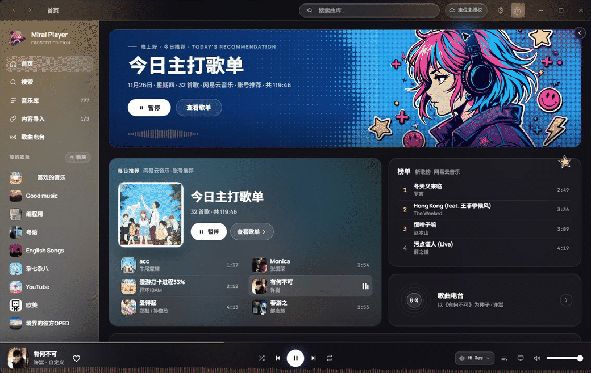
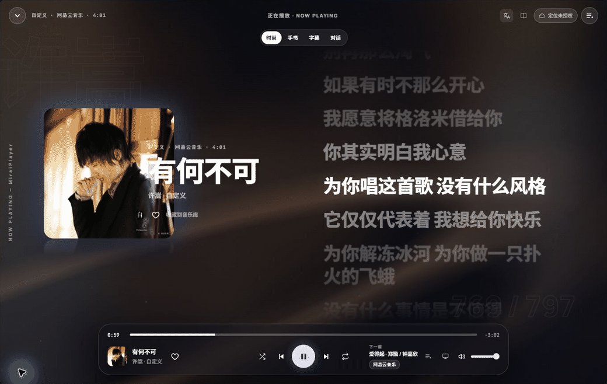
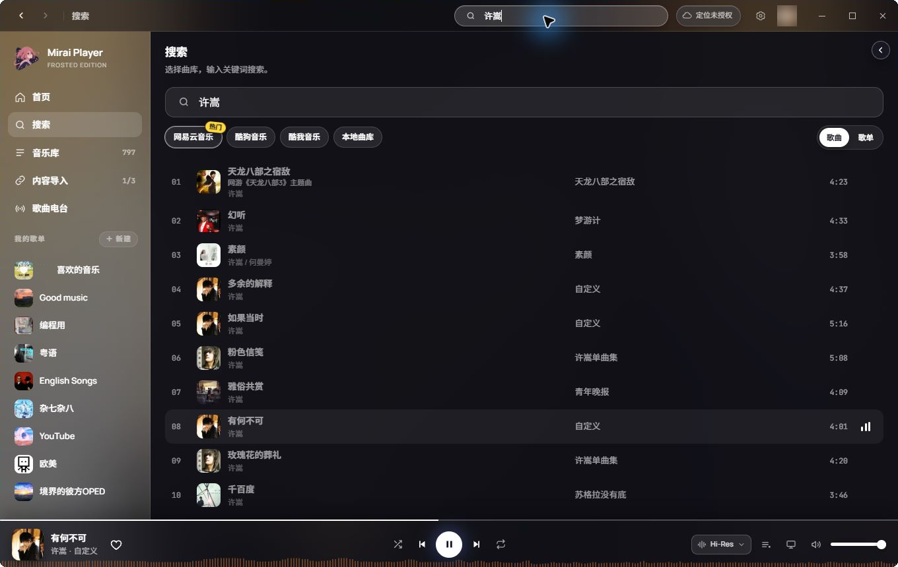
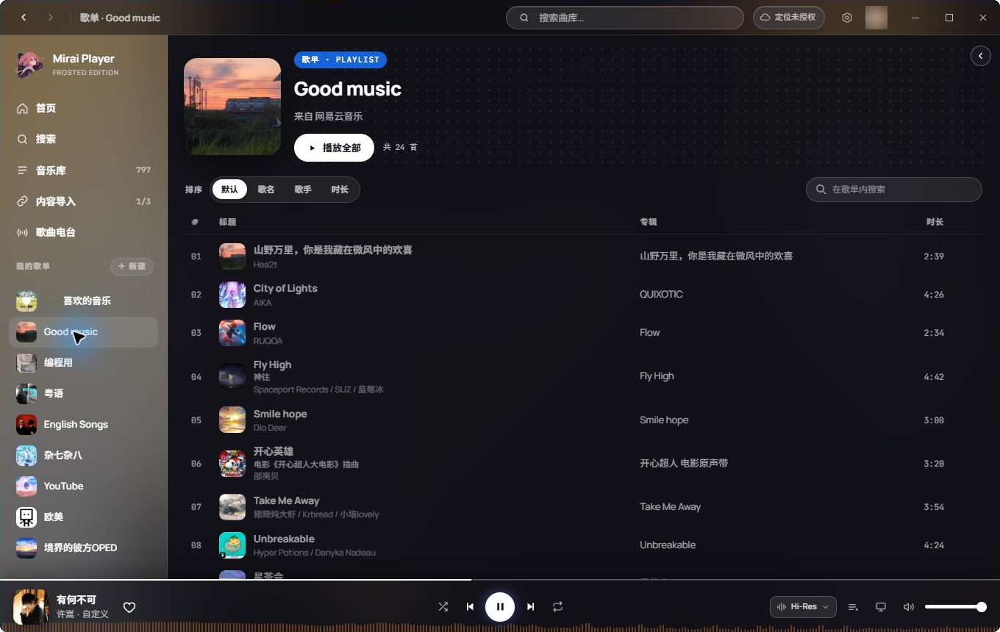
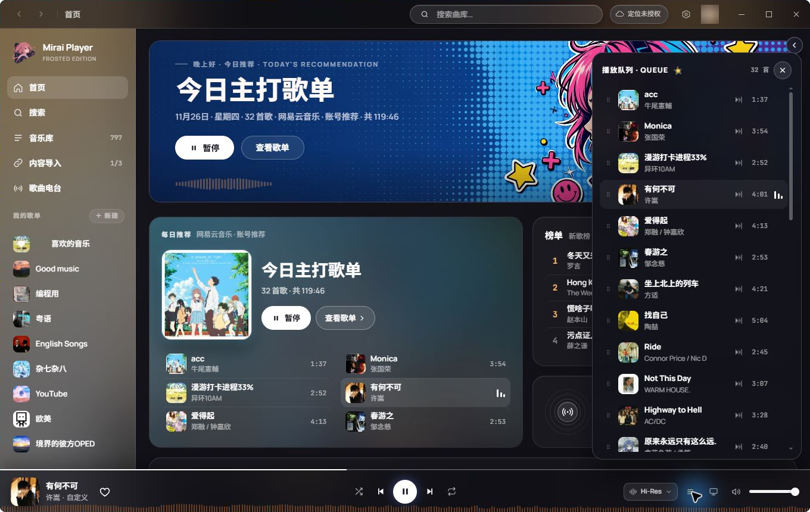
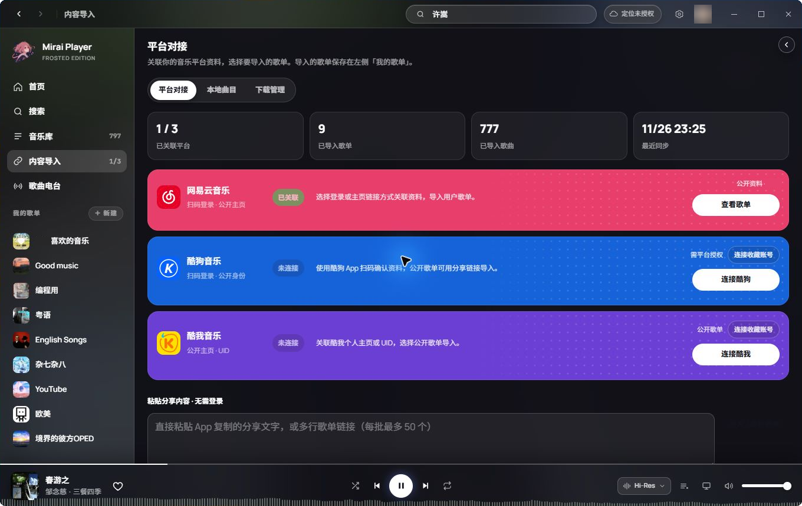
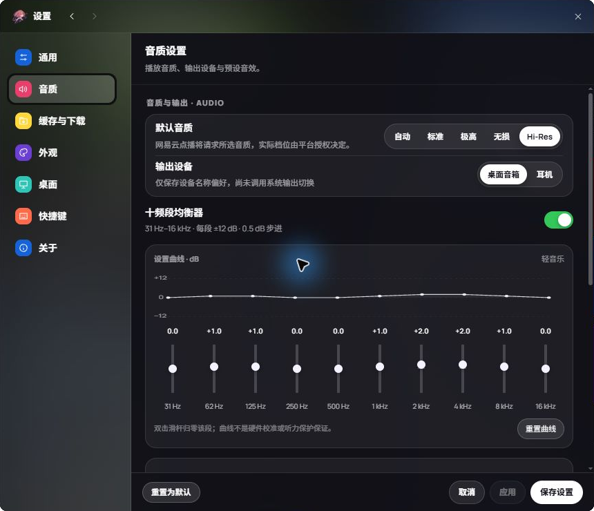
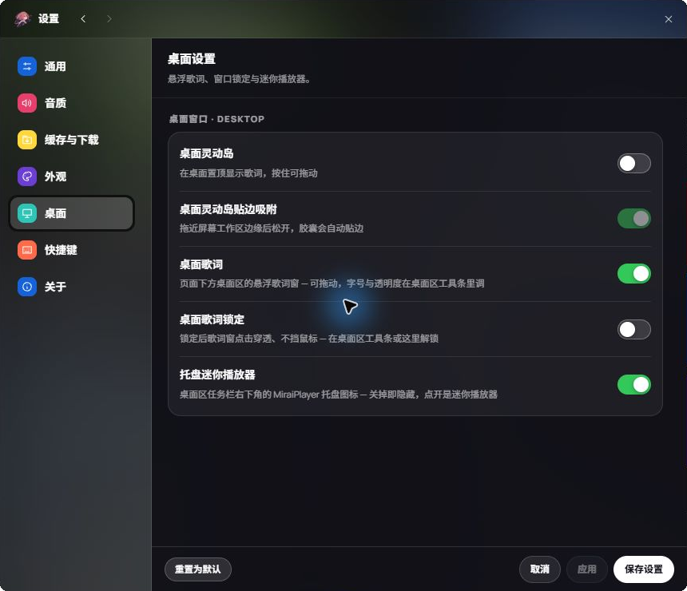

# MiraiPlayer

A glass-styled desktop music player with online catalogs, synchronized lyrics, and floating desktop controls.

[Releases](https://github.com/XiangZi7/MiraiPlayer/releases) · [Development builds](https://github.com/XiangZi7/MiraiPlayer/actions/workflows/release.yml?query=branch%3Amain) · [简体中文](README.md)

## Features

- Search NetEase Cloud Music, Kuwo, and Kugou, import public playlists, and use the library, playback queue, and song radio.
- Switch between four fullscreen lyric layouts with word-by-word timing and translations.
- Choose frosted or liquid glass, tune the 10-band equalizer, and use desktop lyrics, the desktop island, or the mini player.

## Interface preview

### Home and Now Playing



### Fullscreen lyrics



| Search                                                                                       | Playlists                                                                                       |
| -------------------------------------------------------------------------------------------- | ----------------------------------------------------------------------------------------------- |
| [](docs/images/feature-search.png)          | [](docs/images/feature-playlist.png)       |
| **Playback queue**                                                                           | **Platform connections**                                                                        |
| [](docs/images/feature-queue.png)            | [](docs/images/feature-platforms.png) |
| **10-band equalizer**                                                                        | **Desktop settings**                                                                            |
| [](docs/images/feature-equalizer.png) | [](docs/images/feature-desktop.png)         |

## Local development

Install Node.js, pnpm, Rust, and the platform dependencies for Tauri. [Development guide](docs/DEVELOPMENT.md)

```sh
pnpm install --frozen-lockfile
pnpm tauri dev
```

[Playlist imports](docs/platforms.md) · [Playback and audio](docs/playback.md) · [Lyric stages](docs/lyrics.md) · [Desktop windows](docs/desktop.md) · [Report an issue](https://github.com/XiangZi7/MiraiPlayer/issues)
