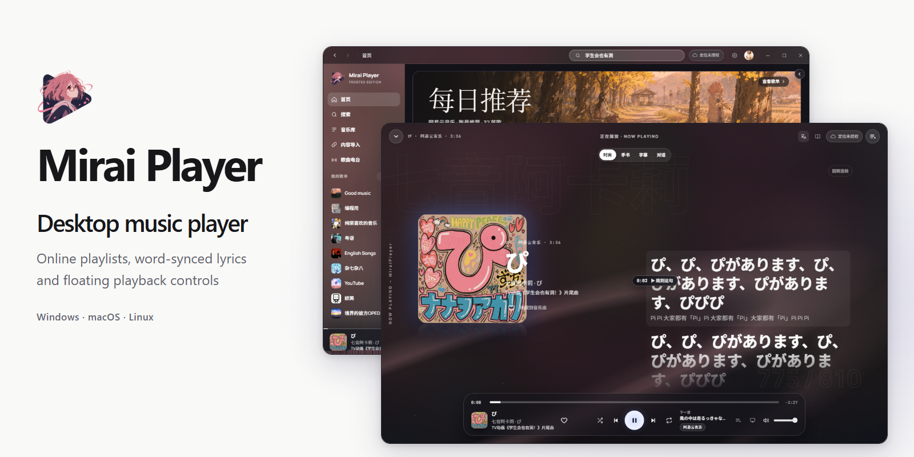
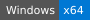
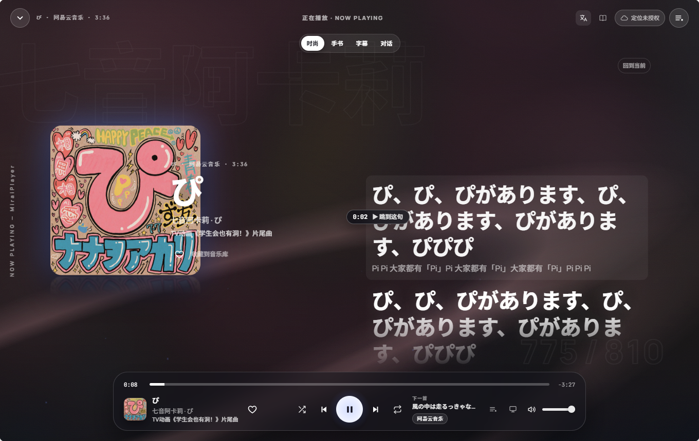
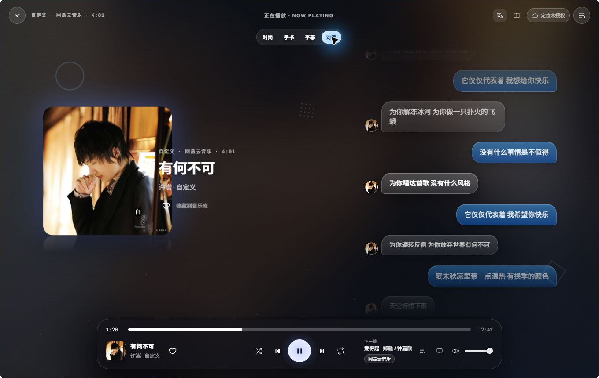

<a href="#downloads-and-installation"></a>

<p align="center"><a href="#downloads-and-installation"><strong>Download desktop builds →</strong></a> · <a href="#quick-start">Quick start</a> · <a href="#documentation">Documentation</a> · <a href="#community">Community</a> · <a href="README.md">简体中文</a></p>

<p align="center">
  <a href="https://github.com/XiangZi7/MiraiPlayer/releases"></a>
  <a href="https://github.com/XiangZi7/MiraiPlayer/actions/workflows/release.yml?query=branch%3Amain"></a>
  <a href="https://github.com/XiangZi7/MiraiPlayer/actions/workflows/release.yml"></a>
  <a href="#downloads-and-installation"></a>
  <a href="#downloads-and-installation"></a>
  <a href="#downloads-and-installation"></a>
</p>

<p align="center">
  <a href="docs/FRONTEND_ARCHITECTURE.md"></a>
  <a href="docs/FRONTEND_ARCHITECTURE.md"></a>
  <a href="docs/FRONTEND_ARCHITECTURE.md"></a>
  <a href="docs/FRONTEND_ARCHITECTURE.md"></a>
  <a href="docs/FRONTEND_ARCHITECTURE.md"></a>
  <a href="docs/FRONTEND_ARCHITECTURE.md"></a>
</p>

<p align="center">
  <a href="docs/platforms.md"></a>
  <a href="docs/playback.md"></a>
  <a href="docs/lyrics.md"></a>
  <a href="docs/desktop.md"></a>
  <a href="docs/appearance.md"></a>
  <a href="docs/storage.md"></a>
</p>

<p align="center">
  <a href="docs/platforms.md"></a>
  <a href="docs/platforms.md"></a>
  <a href="docs/platforms.md"></a>
</p>

MiraiPlayer brings public playlists, word-synchronized lyrics and floating desktop controls into one music player. Search for a track to play it, or import a playlist to keep its track list on this device.

## Interface preview

### Home · account recommendations during playback

<a href="docs/images/feature-home.png"></a>

### Search · opening and ending themes by series name

<a href="docs/images/feature-search.png"></a>

### Playlists · tracks in Good music

<a href="docs/images/feature-playlist.png"></a>

### Queue · the current track and what plays next

<a href="docs/images/feature-queue.png"></a>

### Fashion · album art and synchronized lyrics

<a href="docs/images/feature-fashion.png"></a>

### Handwritten · ink textures and bilingual lyrics

<a href="docs/images/feature-ink.png"></a>

### Subtitles · the current line and its translation

<a href="docs/images/feature-subtitles.png"></a>

### Dialogue · alternating lyric bubbles

<a href="docs/images/feature-chat.png"></a>

### Connections · a linked account and imported playlists

<a href="docs/images/feature-platforms.png"></a>

<sub>Captured in the signed-in Windows desktop app while playing Nanawo Akari’s ぴ. Search and fullscreen playback show the anime ending-theme credit supplied by the music service. <a href="docs/images/README.md">Image sources and reproduction</a></sub>

## Downloads and installation

Published versions appear under Assets on the Releases page. For a development build, open the most recent successful main-branch run, sign in to GitHub and extract the archive for your system. [Releases](https://github.com/XiangZi7/MiraiPlayer/releases) · [GitHub Actions](https://github.com/XiangZi7/MiraiPlayer/actions/workflows/release.yml?query=branch%3Amain)

| System | Package formats |
| --- | --- |
| **Windows** | [](https://github.com/XiangZi7/MiraiPlayer/actions/workflows/release.yml?query=branch%3Amain) [](https://github.com/XiangZi7/MiraiPlayer/actions/workflows/release.yml?query=branch%3Amain) |
| **macOS** | [](https://github.com/XiangZi7/MiraiPlayer/actions/workflows/release.yml?query=branch%3Amain) [](https://github.com/XiangZi7/MiraiPlayer/actions/workflows/release.yml?query=branch%3Amain) |
| **Linux** | [](https://github.com/XiangZi7/MiraiPlayer/actions/workflows/release.yml?query=branch%3Amain) [](https://github.com/XiangZi7/MiraiPlayer/actions/workflows/release.yml?query=branch%3Amain) |

Windows Setup installs for the current user. For the portable ZIP, extract and run `miraiplayer.exe` with WebView2 Runtime installed. On macOS 13.3 or later, open the DMG for your chip and drag the app into Applications. The Mac builds use ad-hoc signing and are currently unnotarized. [WebView2 Runtime](https://developer.microsoft.com/microsoft-edge/webview2/)

Linux x64 packages are built on Ubuntu 22.04. Install the DEB with `sudo apt install ./filename.deb`, or make the AppImage executable and launch it. Every build archive includes a SHA-256 list for its platform. Tagged release drafts collect all six packages. [Packaging and verification](docs/RELEASING.md)

## Quick start

1. Open the player, type a title or artist in the search bar and press Enter. Select a result to play it.
2. Open the platform connections panel and import a public playlist by pasting its full link or shared text.
3. Enter fullscreen for the Fashion, Handwritten, Subtitles or Dialogue layout. Use the system tray for desktop lyrics or the mini player.

| Action | Player shortcut |
| --- | --- |
| Play / pause | `Space` |
| Seek backward / forward five seconds | `←` / `→` |
| Volume up / down, mute | `↑` / `↓`, `M` |
| Leave fullscreen | `Esc` |

## Desktop lyrics and the system tray

The tray menu restores the main window, opens settings and shows desktop lyrics, the mini player or the media card. For a single lyric line, enable the floating desktop capsule in desktop settings and drag it towards the edge of the screen. Edge snapping, lyric locking and close-to-tray behavior have separate controls. [Desktop controls guide](docs/desktop.md)

## Documentation

[Platforms & playlists](docs/platforms.md) · [Playback & audio](docs/playback.md) · [Lyrics & stages](docs/lyrics.md) · [Desktop windows](docs/desktop.md) · [Glass & motion](docs/appearance.md) · [Downloads & data](docs/storage.md)

<details>
<summary>Local development</summary>

Use Node.js 22.22.2, pnpm 10.33.0, Rust 1.96.0 and native Tauri prerequisites. Windows needs C++ Build Tools and WebView2, macOS needs Xcode Command Line Tools, and Linux needs the WebKitGTK, tray and GStreamer packages listed in the workflow. [Tauri prerequisites](https://v2.tauri.app/start/prerequisites/)

```sh
pnpm install --frozen-lockfile
pnpm tauri dev
```

Run `pnpm build` for type checks, a production web build and CSS validation. Use `pnpm release:build` for native packages. The default service is `https://music-api.yxcr.top`. To use another backend, set `VITE_APP_BASE_API` in a root `.env.local` and restart or rebuild.

[Frontend architecture](docs/FRONTEND_ARCHITECTURE.md) · [Performance and tests](docs/PERFORMANCE.md) · [Development notes](docs/DEVELOPMENT.md) · [Release guide](docs/RELEASING.md)

</details>

<details>
<summary>Accounts, local data and playback access</summary>

Imported playlists, public account associations, EQ presets and preferences are stored locally. Windows can keep a NetEase device playback credential in Credential Manager. Actual playback access, quality and preview length depend on the source platform. Local weather requests use location permission. [Platform support](docs/platforms.md) · [Storage and downloads](docs/storage.md)

</details>

[Report an issue](https://github.com/XiangZi7/MiraiPlayer/issues) · [Contribute](https://github.com/XiangZi7/MiraiPlayer/pulls) · [Font licenses](public/font-licenses/) · [Geographic data credits](public/data-licenses/geonames.txt)

<sub>Made by <a href="https://github.com/XiangZi7">XiangZi</a></sub>

## Community

When reporting a playback issue, include the OS, app version, source platform and a public track or playlist link. For UI issues, include the glass style and reproduction steps. The earlier project README contains the two existing QQ community QR codes. [Issues](https://github.com/XiangZi7/MiraiPlayer/issues) · [Project community groups](https://github.com/XiangZi7/MiraiPlayer/blob/f19ae8ec4ed9b66e215cefdff63f46e1495cae6c/README.md#-交流与支持)
