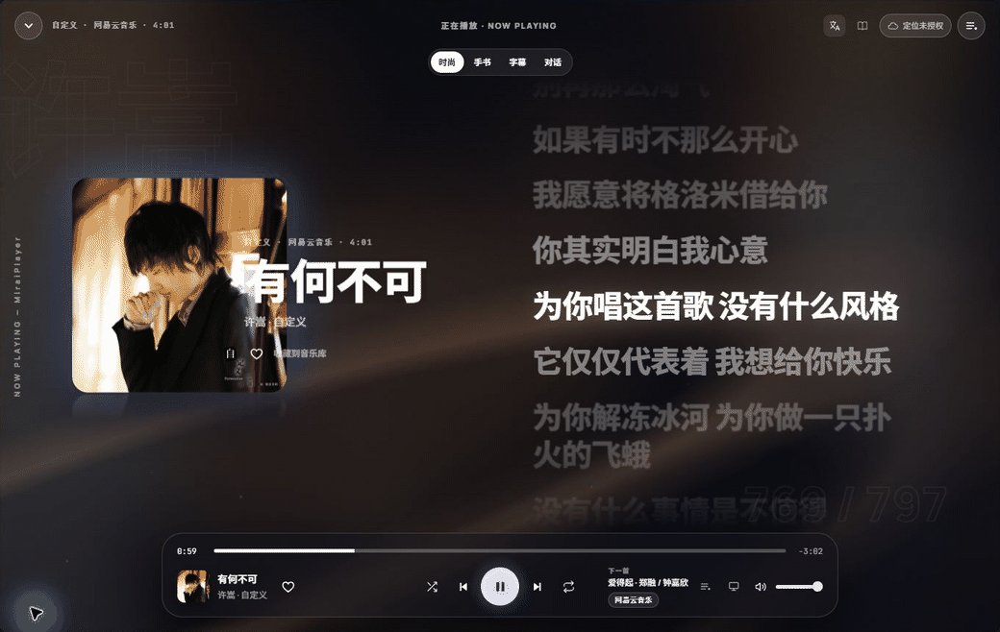
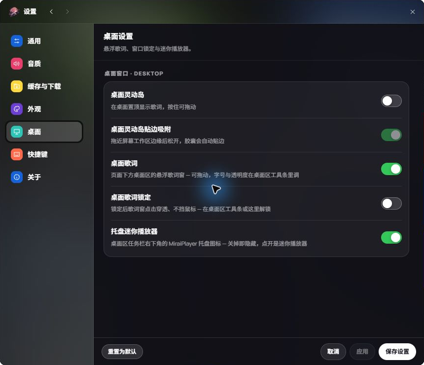

# MiraiPlayer

一款玻璃风格的桌面音乐播放器，支持在线曲库、同步歌词和桌面小窗。

[下载正式版](https://github.com/XiangZi7/MiraiPlayer/releases) · [下载开发构建](https://github.com/XiangZi7/MiraiPlayer/actions/workflows/release.yml?query=branch%3Amain) · [English](README.en.md)

## 功能

- 搜索网易云音乐、酷我和酷狗曲库，导入公开歌单，使用音乐库、播放队列和歌曲电台。
- 全屏提供时尚、手书、字幕、对话四款歌词舞台，支持逐字同步和译文。
- 支持毛玻璃与液态玻璃、十段均衡器、桌面歌词、灵动岛和迷你播放器。

## 界面预览

### 首页与正在播放面板


### 全屏歌词



| 搜索                                                                                  | 我的歌单                                                                            |
| ------------------------------------------------------------------------------------- | ----------------------------------------------------------------------------------- |
| [](docs/images/feature-search.png)         | [](docs/images/feature-playlist.png)   |
| **播放队列**                                                                          | **平台对接**                                                                        |
| [](docs/images/feature-queue.png)           | [](docs/images/feature-platforms.png) |
| **十段均衡器**                                                                        | **桌面设置**                                                                        |
| [](docs/images/feature-equalizer.png) | [](docs/images/feature-desktop.png)     |

## 本地开发

安装 Node.js、pnpm、Rust 和系统所需的 Tauri 构建工具。 [开发环境说明](docs/DEVELOPMENT.md)

```sh
pnpm install --frozen-lockfile
pnpm tauri dev
```

[歌单导入](docs/platforms.md) · [播放与音频](docs/playback.md) · [歌词舞台](docs/lyrics.md) · [桌面小窗](docs/desktop.md) · [反馈问题](https://github.com/XiangZi7/MiraiPlayer/issues)
