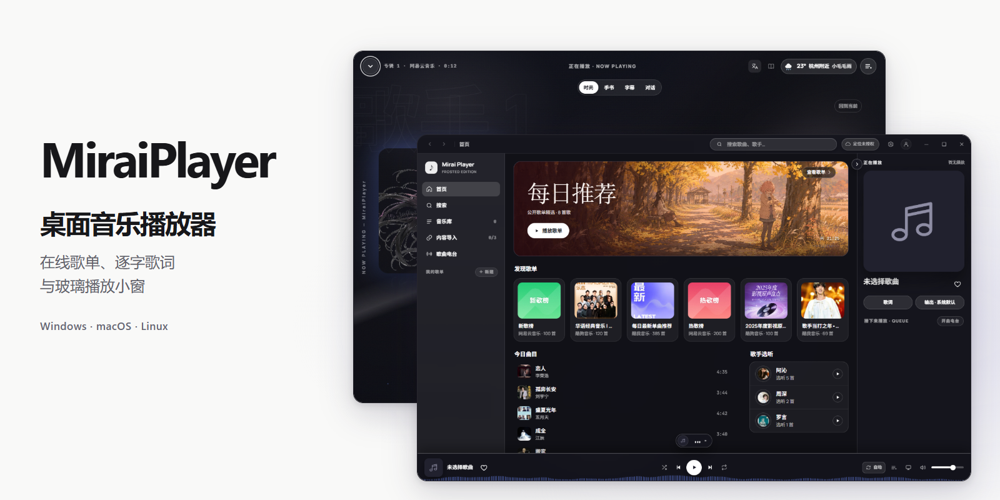
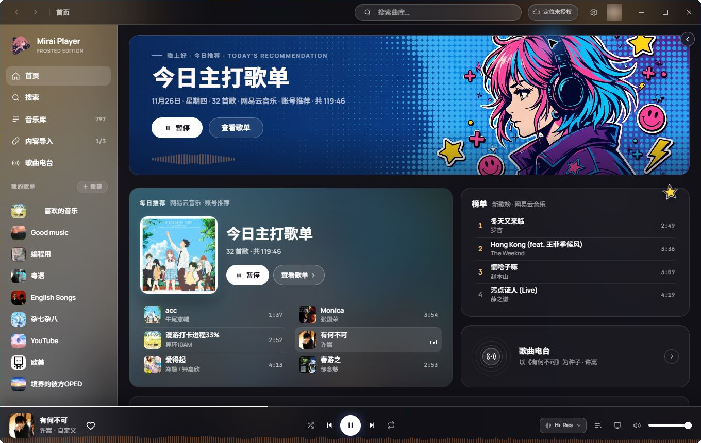
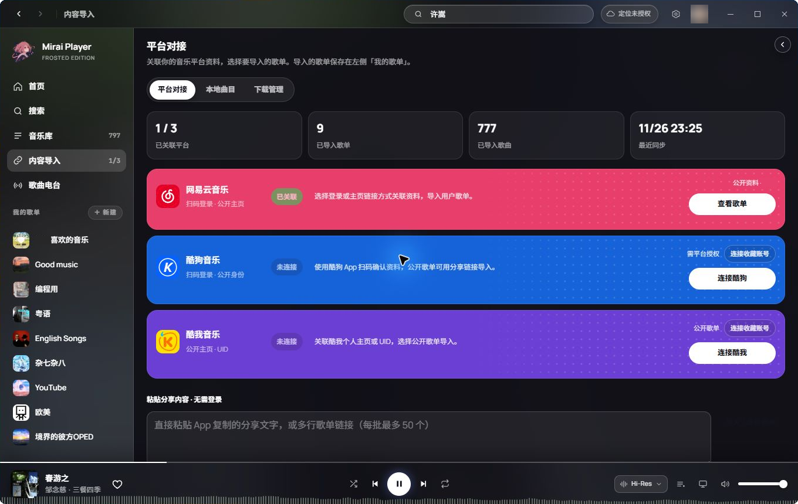
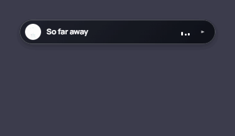

<a href="#下载与安装"></a>

<p align="center"><a href="#下载与安装"><strong>下载桌面版 →</strong></a> · <a href="#快速开始">快速开始</a> · <a href="#文档">文档</a> · <a href="#社区交流">社区交流</a> · <a href="README.en.md">English</a></p>

<p align="center">
  <a href="https://github.com/XiangZi7/MiraiPlayer/releases"></a>
  <a href="https://github.com/XiangZi7/MiraiPlayer/actions/workflows/release.yml?query=branch%3Amain"></a>
  <a href="https://github.com/XiangZi7/MiraiPlayer/actions/workflows/release.yml"></a>
  <a href="#下载与安装"></a>
  <a href="#下载与安装"></a>
  <a href="#下载与安装"></a>
</p>

<p align="center">
  <a href="docs/FRONTEND_ARCHITECTURE.md"></a>
  <a href="docs/FRONTEND_ARCHITECTURE.md"></a>
  <a href="docs/FRONTEND_ARCHITECTURE.md"></a>
  <a href="docs/FRONTEND_ARCHITECTURE.md"></a>
  <a href="docs/FRONTEND_ARCHITECTURE.md"></a>
  <a href="docs/FRONTEND_ARCHITECTURE.md"></a>
</p>

<p align="center">
  <a href="docs/platforms.md"></a>
  <a href="docs/playback.md"></a>
  <a href="docs/lyrics.md"></a>
  <a href="docs/desktop.md"></a>
  <a href="docs/appearance.md"></a>
  <a href="docs/storage.md"></a>
</p>

<p align="center">
  <a href="docs/platforms.md"></a>
  <a href="docs/platforms.md"></a>
  <a href="docs/platforms.md"></a>
</p>

MiraiPlayer 把公开歌单、逐字歌词和桌面播放小窗放在同一个播放器里。搜索一首歌可以直接点播，导入的歌单会留在本机。

## 界面预览

### 首页 · 播放中的每日推荐与已导入歌单

<a href="docs/images/feature-home.png"></a>

### 搜索 · 通过动画作品找到片头曲和片尾曲

<a href="docs/images/feature-search.png"></a>

### 我的歌单 · Good music 的完整曲目

<a href="docs/images/feature-playlist.png"></a>

### 播放队列 · 当前曲目与后续歌曲

<a href="docs/images/feature-queue.png"></a>

### 时尚 · 专辑封面与逐字歌词

<a href="docs/images/feature-fashion.png"></a>

### 手书 · 墨色舞台与双语歌词

<a href="docs/images/feature-ink.png"></a>

### 字幕 · 当前唱词与译文

<a href="docs/images/feature-subtitles.png"></a>

### 对话 · 交替排列的歌词气泡

<a href="docs/images/feature-chat.png"></a>

### 平台对接 · 已关联账号与导入统计

<a href="docs/images/feature-platforms.png"></a>

<sub>实拍自已登录的 Windows 桌面版。播放曲目为七音阿卡莉《ぴ》，搜索和全屏展示来源平台标注的动画片尾曲信息。 <a href="docs/images/README.md">素材与复现说明</a></sub>

## 下载与安装

正式版本发布后可在 Releases 的 Assets 下载。开发版请打开最近一次成功的主分支构建，登录 GitHub 后从 Artifacts 下载对应系统的归档并解压。 [Releases](https://github.com/XiangZi7/MiraiPlayer/releases) · [GitHub Actions](https://github.com/XiangZi7/MiraiPlayer/actions/workflows/release.yml?query=branch%3Amain)

| 系统 | 构建格式 |
| --- | --- |
| **Windows** | [](https://github.com/XiangZi7/MiraiPlayer/actions/workflows/release.yml?query=branch%3Amain) [](https://github.com/XiangZi7/MiraiPlayer/actions/workflows/release.yml?query=branch%3Amain) |
| **macOS** | [](https://github.com/XiangZi7/MiraiPlayer/actions/workflows/release.yml?query=branch%3Amain) [](https://github.com/XiangZi7/MiraiPlayer/actions/workflows/release.yml?query=branch%3Amain) |
| **Linux** | [](https://github.com/XiangZi7/MiraiPlayer/actions/workflows/release.yml?query=branch%3Amain) [](https://github.com/XiangZi7/MiraiPlayer/actions/workflows/release.yml?query=branch%3Amain) |

Windows 安装包提供当前用户安装。免安装 ZIP 解压后运行 `miraiplayer.exe`，需要系统 WebView2。macOS 要求 13.3 或更高版本，打开对应芯片的 DMG 后将应用拖入“应用程序”。当前 macOS 包使用 ad-hoc 签名，尚未公证。 [WebView2 Runtime](https://developer.microsoft.com/microsoft-edge/webview2/)

Linux x64 以 Ubuntu 22.04 构建。用 `sudo apt install ./文件名.deb` 安装 DEB，或给 AppImage 添加执行权限后运行。每个构建归档附有本平台 SHA-256 清单，正式版本的六个分发文件、版本信息和总校验清单长期保存在 GitHub Releases。 [打包与校验](docs/RELEASING.md)

## 快速开始

1. 打开播放器，在标题栏输入歌名或歌手并按回车，选择搜索结果播放。
2. 打开“平台对接”，粘贴完整的公开歌单详情链接或 App 分享文字，再确认导入。
3. 进入全屏播放，切换时尚、手书、字幕或对话舞台。需要小窗时从系统托盘打开桌面歌词或迷你播放器。

| 常用操作 | 播放器快捷键 |
| --- | --- |
| 播放 / 暂停 | `Space` |
| 快退 / 快进 5 秒 | `←` / `→` |
| 音量增减 / 静音 | `↑` / `↓`, `M` |
| 关闭全屏播放 | `Esc` |

## 桌面歌词与托盘

托盘菜单可以恢复主播放器、打开独立设置窗，或显示桌面歌词、迷你播放器和媒体控制卡片。只想看一行歌词时，在“设置 → 桌面”打开桌面灵动岛，再拖动歌词胶囊到屏幕边缘。可分别控制贴边吸附、歌词锁定和关闭主窗后是否留在托盘。 [桌面操作指南](docs/desktop.md)

点击歌词胶囊，封面会随面板一起展开，露出歌曲进度和播放控件。点右上角的箭头即可收回一行歌词。



## 文档

[平台连接与歌单](docs/platforms.md) · [队列与音频](docs/playback.md) · [全屏歌词舞台](docs/lyrics.md) · [桌面窗口](docs/desktop.md) · [玻璃与动效](docs/appearance.md) · [下载与数据](docs/storage.md)

<details>
<summary>本地开发</summary>

使用 Node.js 22.22.2、pnpm 10.33.0、Rust 1.96.0 和所在系统的 Tauri 构建工具。Windows 需要 C++ Build Tools 和 WebView2，macOS 需要 Xcode Command Line Tools，Linux 的 WebKitGTK、托盘及 GStreamer 依赖列在发行工作流中。 [Tauri prerequisites](https://v2.tauri.app/start/prerequisites/)

```sh
pnpm install --frozen-lockfile
pnpm tauri dev
```

`pnpm build` 运行前端类型检查、生产构建与 CSS 校验。`pnpm release:build` 将本平台安装包、版本信息和校验清单写入仓库根目录的 `release-output/`。`pnpm release --dry-run` 可预览下一版本。默认服务为 `https://music-api.yxcr.top`，自建后端可在根目录 `.env.local` 配置 `VITE_APP_BASE_API` 并重启开发服务或重建。

[前端架构](docs/FRONTEND_ARCHITECTURE.md) · [性能与回归](docs/PERFORMANCE.md) · [开发详解](docs/DEVELOPMENT.md) · [发版说明](docs/RELEASING.md)

</details>

<details>
<summary>账号、数据与播放权限</summary>

公开歌单、账号关联、EQ 预设和播放偏好保存在设备上。Windows 可使用系统凭据管理器保存网易云设备播放授权。歌曲是否可播、音质及试听范围由来源平台当次授权决定。天气由用户授权后按当前位置请求。 [平台支持范围](docs/platforms.md) · [数据与下载](docs/storage.md)

</details>

[反馈问题](https://github.com/XiangZi7/MiraiPlayer/issues) · [参与贡献](https://github.com/XiangZi7/MiraiPlayer/pulls) · [字体授权](public/font-licenses/) · [地名数据来源](public/data-licenses/geonames.txt)

<sub>Made by <a href="https://github.com/XiangZi7">XiangZi</a></sub>

## 社区交流

反馈播放问题时，可以附上系统、应用版本、来源平台和可公开访问的曲目或歌单链接。界面问题可以补充当前材质及重现步骤。项目原有两个 QQ 交流群的二维码保存在旧版项目说明中。 [Issues](https://github.com/XiangZi7/MiraiPlayer/issues) · [项目交流群](https://github.com/XiangZi7/MiraiPlayer/blob/f19ae8ec4ed9b66e215cefdff63f46e1495cae6c/README.md#-交流与支持)
