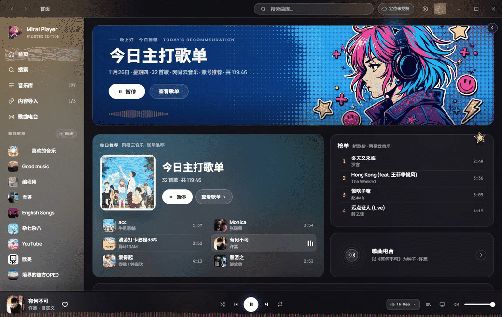

# MiraiPlayer

一款融合简约美学、毛玻璃、Liquid Glass 液态玻璃与 Pop Art 波普艺术风格的高颜值桌面音乐播放器，支持网易云音乐、酷狗音乐、酷我音乐。

<p align="center"><a href="#下载"><strong>下载桌面版 ↓</strong></a> · <a href="#功能">功能</a> · <a href="#本地开发">本地开发</a> · <a href="README.en.md">English</a></p>

<p align="center">
  <a href="https://github.com/XiangZi7/MiraiPlayer/releases"></a>
  <a href="https://github.com/XiangZi7/MiraiPlayer/actions/workflows/release.yml?query=branch%3Amain"></a>
  <a href="https://github.com/XiangZi7/MiraiPlayer/actions/workflows/release.yml"></a>
  <a href="#下载"></a>
  <a href="#下载"></a>
  <a href="#下载"></a>
</p>

<p align="center">
  <a href="docs/FRONTEND_ARCHITECTURE.md"></a>
  <a href="docs/FRONTEND_ARCHITECTURE.md"></a>
  <a href="docs/FRONTEND_ARCHITECTURE.md"></a>
  <a href="docs/FRONTEND_ARCHITECTURE.md"></a>
  <a href="docs/FRONTEND_ARCHITECTURE.md"></a>
  <a href="docs/FRONTEND_ARCHITECTURE.md"></a>
</p>

## 下载

| 系统 | 下载 v0.1.10 |
| --- | --- |
| **Windows** | [][windows-setup] [][windows-portable] |
| **macOS** | [][macos-arm64] [][macos-x64] |
| **Linux** | [][linux-appimage] [][linux-deb] |

[最新正式版][latest] · [历史版本][releases] · [开发构建][dev-builds]

## 功能

| 功能 | 支持内容 |
| --- | --- |
| 🎵 [在线曲库](docs/platforms.md) | 网易云音乐、酷狗音乐、酷我音乐搜索，公开歌单导入与音乐库 |
| 🎧 [播放与音效](docs/playback.md) | 播放队列、歌曲电台、十段均衡器 |
| 🎤 [同步歌词](docs/lyrics.md) | 逐字歌词与译文，时尚、手书、字幕、对话四款全屏舞台 |
| 🎨 [界面风格](docs/appearance.md) | 毛玻璃、液态玻璃、波普艺术点缀 |
| 🖥️ [桌面小窗](docs/desktop.md) | 桌面歌词、灵动岛、迷你播放器 |
| 💾 [曲目下载](docs/storage.md) | 下载平台允许提供的曲目 |

## 界面预览




## 本地开发

```sh
pnpm install --frozen-lockfile
pnpm tauri dev
```

[开发环境](docs/DEVELOPMENT.md) · [打包与发布](docs/RELEASING.md) · [反馈问题](https://github.com/XiangZi7/MiraiPlayer/issues)

## ⚠️ 免责声明

本项目仅用于学习和研究目的。使用该项目的用户需自行承担相关风险。本项目所使用的相关 API 和数据源均为第三方提供，使用时请遵循相关法律法规及第三方的使用条款。**本项目不得用于任何商业目的**，我们不对任何由于使用本项目而引起的直接或间接的损失或法律责任负责。

## 💬 交流与支持

| QQ 交流 2 群 · 657282337 | QQ 交流群 · 442179941 |
| :---: | :---: |
|  |  |

## 🤝 友情链接

- [HotPulse](https://hotpulse.pages.dev/) · 全网热点聚合平台
- [番剧](https://tv.yxcr.top/)

## 📈 Star 趋势

<a href="https://www.star-history.com/?repos=XiangZi7%2FMiraiPlayer&amp;type=date">
  <picture>
    <source media="(prefers-color-scheme: dark)" srcset="https://api.star-history.com/chart?repos=XiangZi7%2FMiraiPlayer&amp;type=date&amp;theme=dark" />
    
  </picture>
</a>

[latest]: https://github.com/XiangZi7/MiraiPlayer/releases/latest
[releases]: https://github.com/XiangZi7/MiraiPlayer/releases
[dev-builds]: https://github.com/XiangZi7/MiraiPlayer/actions/workflows/release.yml?query=branch%3Amain
[windows-setup]: https://github.com/XiangZi7/MiraiPlayer/releases/download/v0.1.10/MiraiPlayer_0.1.10_windows_x64_setup.exe
[windows-portable]: https://github.com/XiangZi7/MiraiPlayer/releases/download/v0.1.10/MiraiPlayer_0.1.10_windows_x64_portable.zip
[macos-arm64]: https://github.com/XiangZi7/MiraiPlayer/releases/download/v0.1.10/MiraiPlayer_0.1.10_macos_arm64.dmg
[macos-x64]: https://github.com/XiangZi7/MiraiPlayer/releases/download/v0.1.10/MiraiPlayer_0.1.10_macos_x64.dmg
[linux-appimage]: https://github.com/XiangZi7/MiraiPlayer/releases/download/v0.1.10/MiraiPlayer_0.1.10_linux_x64.AppImage
[linux-deb]: https://github.com/XiangZi7/MiraiPlayer/releases/download/v0.1.10/MiraiPlayer_0.1.10_linux_x64.deb
