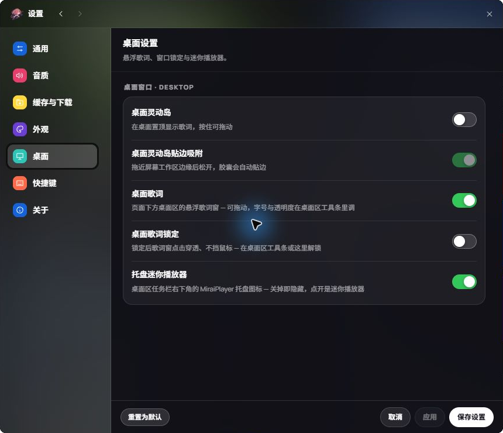
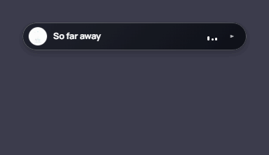

# 桌面窗口与系统托盘

点击系统托盘图标可恢复主窗，菜单提供桌面歌词、迷你播放器、媒体控制卡片、设置和退出。Windows 可显示与主窗一致的托盘菜单，其他支持的桌面环境使用原生菜单。Linux 上托盘图标的展示位置取决于桌面环境。

## 选哪一种小窗

| 窗口 | 用途 |
| --- | --- |
| 桌面歌词 | 在主窗外阅读歌词，可根据需要锁定或解锁 |
| 迷你播放器 | 查看封面和曲名，进行常用播放操作，失焦或 Esc 可收起 |
| 媒体控制卡片 | 紧凑的播放器控制面板，随主播放器同步 |
| 桌面灵动岛 | 使用可拖动的置顶歌词胶囊，主窗最小化后仍可显示 |

媒体控制卡片由 MiraiPlayer 自己绘制。若要关闭单个小窗，使用该表面的“关闭小窗”；从托盘选择“退出播放器”才会结束整个应用。

## 移动灵动岛

1. 在“设置 → 桌面”打开“灵动岛”。只需窗内歌词时保持窗内显示。
2. 勾选“在桌面显示灵动岛”并应用，胶囊会作为置顶小窗显示。
3. 开启“桌面灵动岛贴边吸附”后，拖近当前显示器工作区边缘再松手。需要自由摆放时关闭吸附。多屏的位置按所在屏幕的工作区计算。

轻点胶囊即可展开，查看曲名、调整进度或切歌。点右上角箭头或按 `Esc`，即可收回歌词胶囊。

## 关闭主窗后的行为

在“设置 → 通用”选择关闭主窗口时是否收起到系统托盘。开启后当前播放可继续，从托盘菜单恢复；关闭该选项后，关闭主窗会退出播放器。

## 验收

浏览器可检查设置草稿与材质切换。托盘定位、焦点切换、系统缩放、桌面置顶与歌词锁定需要实际桌面环境。Windows 原生验证入口为 `pnpm check:native`，独立浏览器的吸附与位置验证入口为 `pnpm check:island-position`。[开发与验证](DEVELOPMENT.md)
