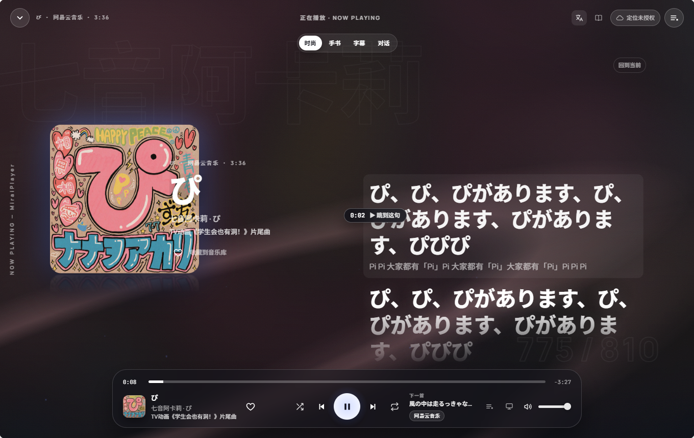
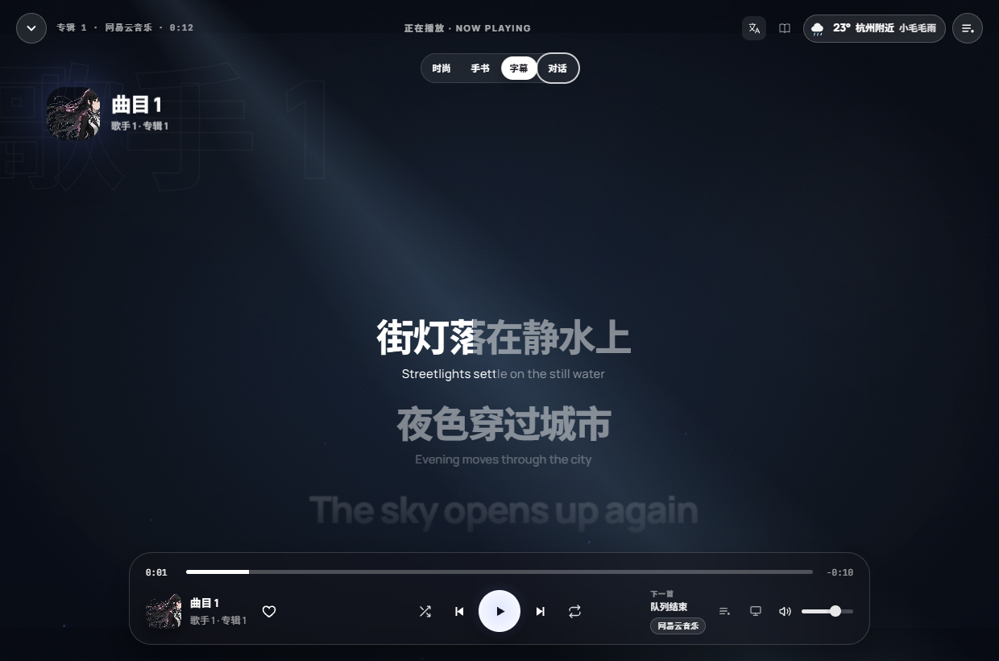

# 全屏播放与逐字歌词

从播放界面进入全屏，用顶部的胶囊切换四种舞台。切换不会改变当前播放曲目。

| 舞台 | 画面与阅读方式 |
| --- | --- |
| 时尚 | 大封面、跨封面曲名与倒影，双层极光背景，右侧大字歌词 |
| 手书 | 墨色背景和手写排版，保留原文与译文的行距 |
| 字幕 | 画面集中展示当前句及相邻歌词，适合远距离观看 |
| 对话 | 带头像的气泡交替排列，同一气泡内展示原文与译文 |

有作品标注的曲目在全屏时仍会显示这条信息。图中《ぴ》的专辑名与曲名相同，动画片尾曲说明单独显示。切换舞台会保留当前歌曲与进度。

## 时间轴与翻译

网易云提供逐字时间戳时，已唱部分跟随实际进度填白，未唱部分保持较低亮度。只有逐行 LRC 时按句跟随。前奏、间奏、无译文或只有部分译文的曲目，按实际返回的内容显示。平台未提供时间轴时不能展示逐字填色。

## 浏览与跳转

- 手动滚动可以暂时脱离跟随，使用“回到当前”立即恢复。停止浏览约 3.2 秒后会重新跟随，键盘焦点停留在歌词上时可继续阅读。
- 使用上下键、Home 和 End 浏览歌词。按回车、空格或点击歌词行可跳到对应时间。
- 用译文按钮控制双语显示。阅读模式将歌词居中并暂停封面组浮动。阅读和译文开关属于当前会话。

## 动效与长歌词

切歌使用分层过渡。连续切歌时会取消过时的动画，最后选中的歌曲继续播放。关闭界面动效或使用系统减少动态效果后，歌词使用静态高亮。长歌词按组保留占位高度，并挂载视区及焦点附近的行，跳到靠后的歌词仍使用原始时间点。[歌词性能验证](PERFORMANCE.md)
