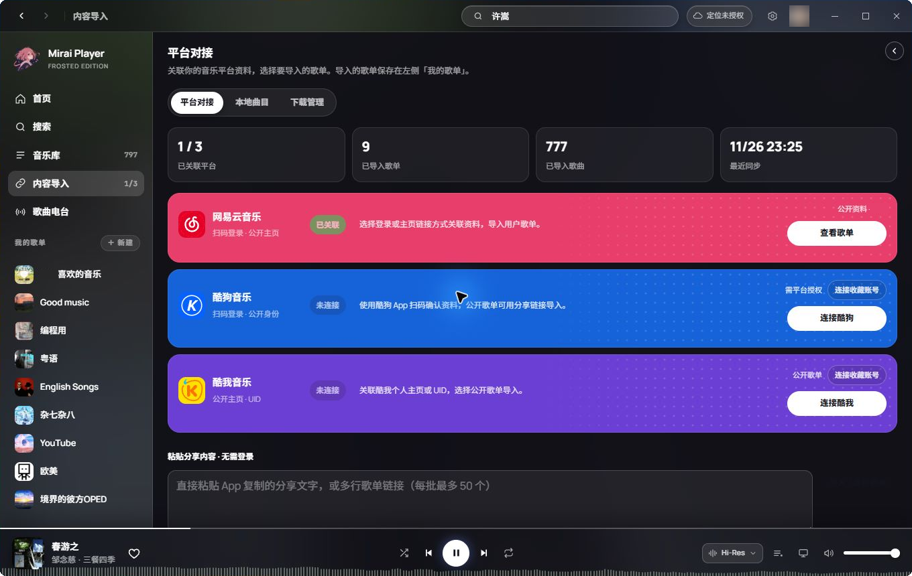
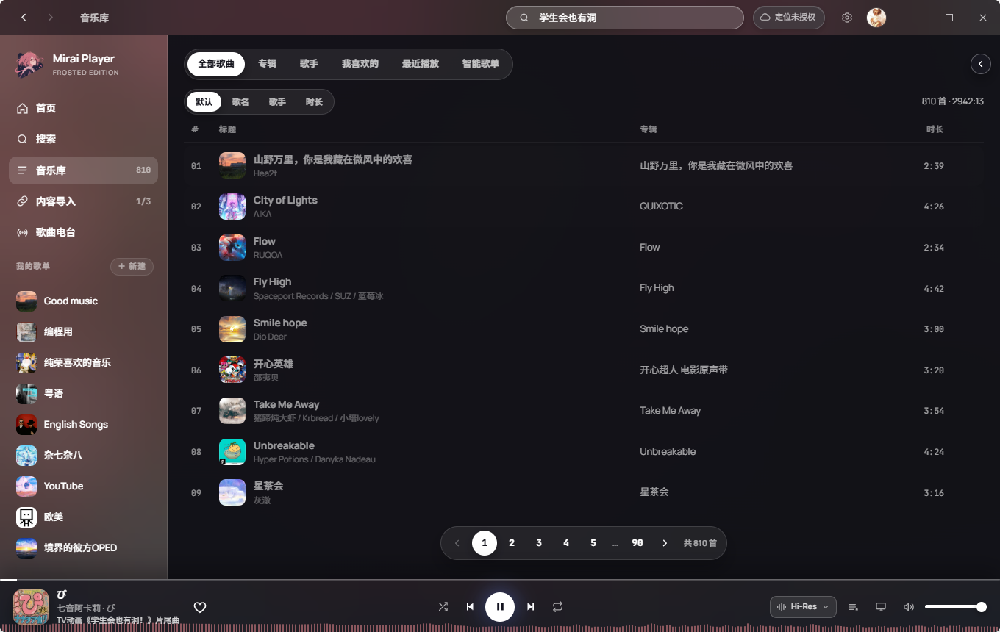

# 平台连接与公开歌单

从标题栏搜索一首歌可以直接试听或播放。要把歌单留在本机，可在侧栏打开“平台对接”。账号关联和分享链接是两个独立入口。

## 选择入口

| 平台 | 扫码 | 主页 / UID | 公开歌单链接 |
| --- | --- | --- | --- |
| 网易云 | 平台确认身份后关联账号，可按当前播放授权点播 | 可读取该 UID 的公开歌单 | 支持 |
| 酷我 | 使用公开主页入口 | 支持 | 支持 |
| 酷狗 | 可关联已确认的公开身份 | 账户歌单读取受限 | 支持 |

只导入别人分享的一份歌单时，直接使用分享链接即可。要批量选择自己账号的公开歌单，可先关联公开主页或扫码。头像和昵称来自平台返回的公开资料。

## 从分享内容导入

1. 在音乐平台复制歌单的完整详情链接或含链接的分享文字。在“粘贴分享内容”中可分多行粘贴，一批最多 50 个。
2. 核对播放器识别出的歌单。重复链接会合并，已经导入的歌单也可以重新勾选更新。
3. 应用读取曲目分页，整份成功后才保存。单份导入成功可打开详情，多份导入保留在当前页面继续操作。
4. 部分失败时可重试未完成项。停止导入或离开页面会保留此前已完成的歌单。短链接无法识别时，到平台歌单详情页复制带数字 ID 的完整地址。

## 从账号选择

选择平台后可在歌单选择窗中勾选本页、取消本页或跨页保留选择。网易云扫码后需要平台确认身份并返回一致的 UID。扫码成功但公开歌单尚未读取完成时，可在已确认身份面板重试。

导入后可以在左侧进入相应歌单，也可以在音乐库查看已有曲目。

## 首页与播放权限

首页发现歌单从三个平台各读取两份公开列表的近期预览。打开卡片或使用快捷播放时才读取完整分页。一个来源暂不可用时可以浏览其他成功项，再点击重试。导入保存的是歌单内容，实际能否播放、是否试听以及允许的音质在点播时由平台决定。

## 登录资料

网易云扫码并授予收藏权限后，播放器会读取该账号的喜欢列表。播放自己喜欢的歌曲时，底栏、全屏和小窗都会亮起红心。从搜索或其他歌单播放同一首歌也会显示相同状态。点击红心可向网易云添加或取消喜欢；平台返回失败时会提示并恢复原状态。

仅关联公开 UID 时，播放器可根据平台标记识别属于该 UID 的公开喜欢歌单。向账号写入收藏需要扫码授权。酷狗、酷我目前接入的接口缺少账号收藏写入权限，点击时会显示平台支持情况。本地曲目的收藏保存在设备上。

升级前已在本机收藏的在线曲目，仍可在「我喜欢的 → 旧版本机收藏」中打开。账号红心以当前平台返回的数据为准。

公开身份与导入列表保存在当前设备。Windows 的网易云设备播放授权可保存到系统凭据管理器，浏览器预览使用临时会话。需要切换账号时从平台入口解除或重新关联。反馈问题可提供平台、错误提示与公开歌单链接。[数据与下载](storage.md) · [开发验证](DEVELOPMENT.md)
