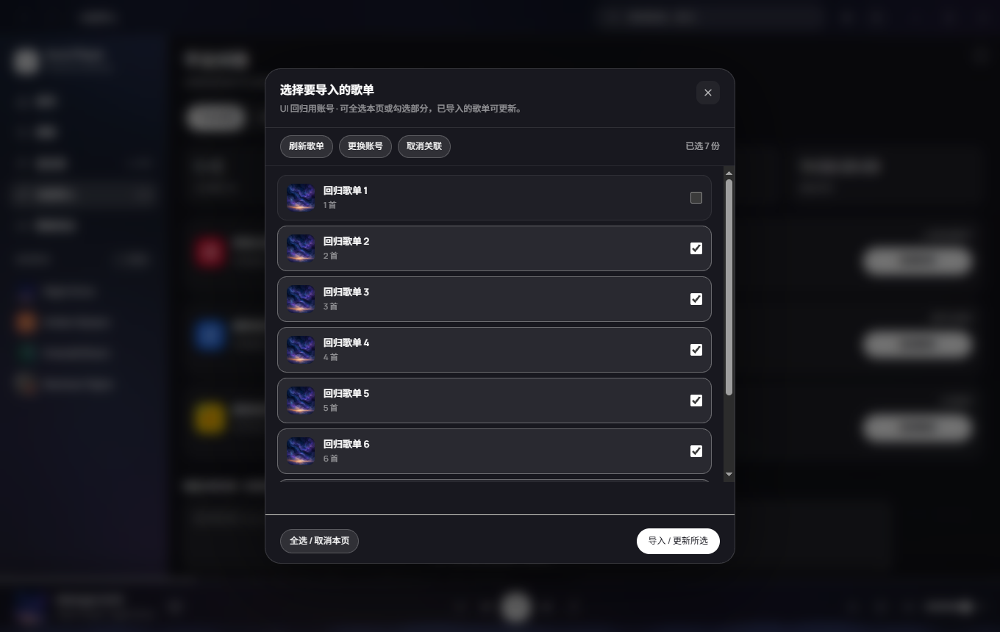
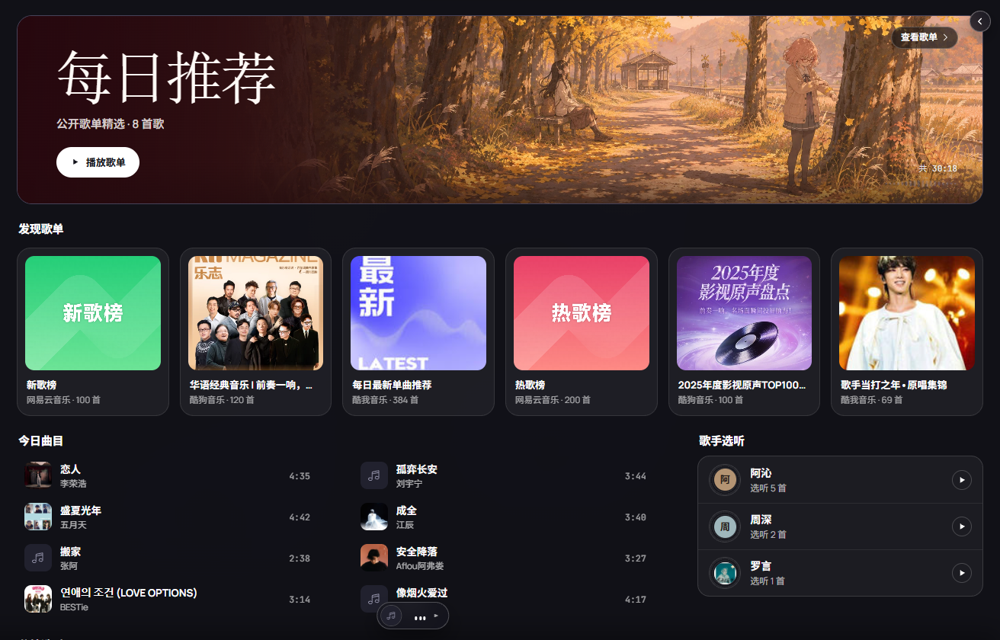

# 平台连接与公开歌单

从标题栏搜索一首歌可以直接试听或播放。要把歌单留在本机，可在侧栏打开“平台对接”。账号关联和分享链接是两个独立入口。

## 选择入口

| 平台 | 账号连接 | 主页 / UID | 公开歌单链接 |
| --- | --- | --- | --- |
| 网易云 | 平台确认身份后关联账号，可按当前播放授权点播 | 可读取该 UID 的公开歌单 | 支持 |
| 酷我 | 桌面收藏使用短信验证码登录 | 支持 | 支持 |
| 酷狗 | 扫码关联公开资料，桌面收藏可选标准版或概念版 | 可关联扫码取得的公开身份 | 支持 |

只导入别人分享的一份歌单时，直接使用分享链接即可。要批量选择自己账号的公开歌单，可先关联公开主页或扫码。头像和昵称来自平台返回的公开资料。

## 从分享内容导入

1. 在音乐平台复制歌单的完整详情链接或含链接的分享文字。在“粘贴分享内容”中可分多行粘贴，一批最多 50 个。
2. 核对播放器识别出的歌单。重复链接会合并，已经导入的歌单也可以重新勾选更新。
3. 应用读取曲目分页，整份成功后才保存。单份导入成功可打开详情，多份导入保留在当前页面继续操作。
4. 部分失败时可重试未完成项。停止导入或离开页面会保留此前已完成的歌单。短链接无法识别时，到平台歌单详情页复制带数字 ID 的完整地址。

## 从账号选择

选择平台后可在歌单选择窗中勾选本页、取消本页或跨页保留选择。网易云扫码后需要平台确认身份并返回一致的 UID。扫码成功但公开歌单尚未读取完成时，可在已确认身份面板重试。

导入后可以在左侧进入相应歌单，也可以在音乐库查看已有曲目。

## 首页与播放权限

首页「发现歌单」展示当前平台的热门歌单。「更多歌单」进入「音乐库 → 歌单」，可切换网易云、酷狗或酷我并翻页。访客从网易云开始，已登录或关联的身份只决定默认平台。网易云和酷我可按平台分类浏览，酷我的全部分类支持热门、最新排序，酷狗可切换最热、推荐、热藏和飙升频道。输入关键词后，使用当前平台的公开歌单搜索。打开卡片或快捷播放时才读取完整曲目。导入保存的是歌单内容，实际能否播放、是否试听以及允许的音质在点播时由平台决定。

### 热门歌单接口索引

播放器通过 `getPopularPlaylists` 请求 MiraiMusic-Server 的 `GET /api/v1/{platform}/playlists/popular`。`pageNum` 与 `pageSize` 控制分页，`category` 与 `order` 的可用值由 `GET /api/v1/{platform}/playlists/filters` 返回。服务端保留平台排列顺序，使用 `hasMore` 和可选的 `total` 分页。上游变化时，从服务端 `providers/` 对应的 `popular_playlists` 方法开始排查。

| 平台 | 上游入口 | 参考实现 |
| --- | --- | --- |
| 网易云 | `/api/playlist/list`，`cat=全部`、`order=hot` | [NeteaseCloudMusicApiEnhanced 的分类歌单](https://github.com/Mirakelor/NeteaseCloudMusicApiEnhanced/blob/35fb65be112714d1a9c9a4495fde0d090c4e4f77/module/top_playlist.js) |
| 酷狗 | `/yy/special/index/{page}-6-0.html`，官网「最热」目录 | [官网最热目录](https://www.kugou.com/yy/special/index/1-6-0.html) · [KuGouMusicApi 的安卓推荐列表](https://github.com/MakcRe/KuGouMusicApi/blob/9ab1ba2e3a64d2eb9a244b535d1ce4248f76fa5b/module/top_playlist.js) |
| 酷我 | `/newh5app/wapi/api/www/classify/playlist/getRcmPlayList`，`order=hot` | [TuneWeave 的公开目录](https://github.com/MOPELotus/TuneWeave/blob/5bcda294b03e9903eb579473834f09a77f01abab/crates/tuneweave-provider-kuwo/src/client/playlist_catalog.rs) |

实测酷狗官网最热目录的后续页重复第一页。服务端按第一页实际提供的不同歌单分页。目录没有曲目数时，卡片只显示歌单名称，详情打开后读取实际曲目数。

## 登录资料

网易云扫码并授予收藏权限后，播放器会读取该账号的喜欢列表。播放自己喜欢的歌曲时，底栏、全屏和小窗都会亮起红心。从搜索或其他歌单播放同一首歌也会显示相同状态。点击红心可向网易云添加或取消喜欢；平台返回失败时会提示并恢复原状态。

仅关联公开 UID 时，播放器可根据平台标记识别属于该 UID 的公开喜欢歌单。本地曲目的收藏保存在设备上。

### 桌面版连接酷狗或酷我的收藏账号

1. 下载适合本机系统的 TuneWeave 并启动。已核对的版本为 `v1.0.0-beta.4`，默认服务地址为 `127.0.0.1:7832`。保持它运行即可在桌面播放器中使用收藏。[TuneWeave 发布包](https://github.com/MOPELotus/TuneWeave/releases/tag/v1.0.0-beta.4)
2. 在「平台对接」选择对应平台的收藏入口。酷狗可以选择标准版或概念版，使用所选版本的 App 扫码。酷我使用大陆手机号和短信验证码。登录后核对界面显示的收藏账号 UID。
3. 打开「我喜欢的」浏览已读回的账号歌曲。从搜索、歌单或小窗点同一首歌的红心，都将修改其来源平台的收藏。酷狗曲目需要能核对到对应的歌曲 ID，无法确认时播放器会提示。

仅使用酷狗概念版扫码时，可以读取喜欢列表。系统歌单仍名为「我喜欢」且歌曲只出现一次时，可以直接取消喜欢。在概念版收藏账号面板用标准版补扫一次，即可通过同一账号添加喜欢或移除重复收藏。播放器会核对两次授权的 UID 和系统喜欢歌单 ID，并在写入后从概念版读回结果。

酷狗和酷我的收藏登录仅在当前播放器进程中有效。公开主页可以指向另一个人，红心始终对应收藏入口显示的账号。可在这个入口退出收藏账号。

要核对同步结果，在播放器里给一首未收藏的歌曲点亮红心，然后在同一账号的官方 App 刷新「我喜欢」。在播放器里取消喜欢，再次刷新，歌曲应从该列表移出。从播放器搜索同一首歌曲，播放栏应显示相同的红心状态。

升级前已在本机收藏的在线曲目，仍可在「我喜欢的 → 旧版本机收藏」中打开。账号红心以当前平台返回的数据为准。

公开身份与导入列表保存在当前设备。Windows 的网易云设备播放授权可保存到系统凭据管理器，浏览器预览使用临时会话。需要切换账号时从平台入口解除或重新关联。反馈问题可提供平台、错误提示与公开歌单链接。[数据与下载](storage.md) · [开发验证](DEVELOPMENT.md)
