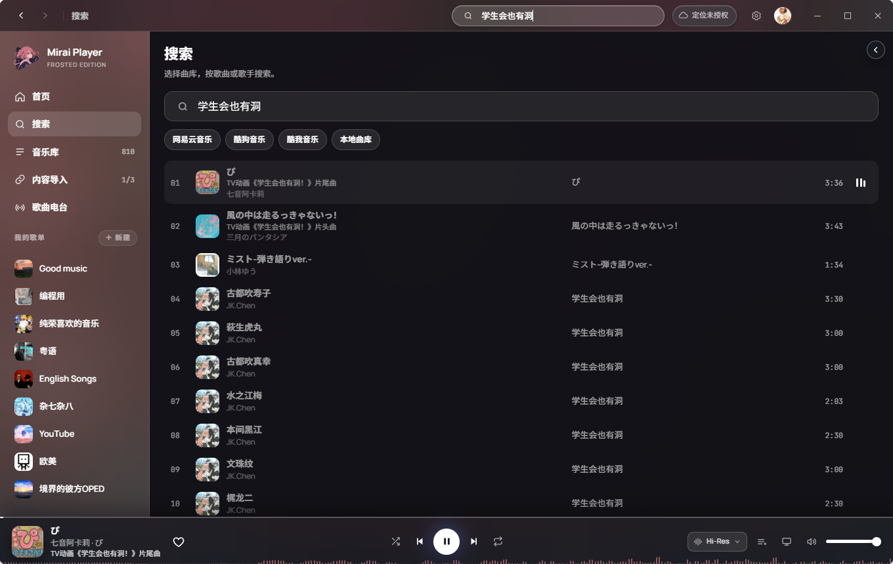
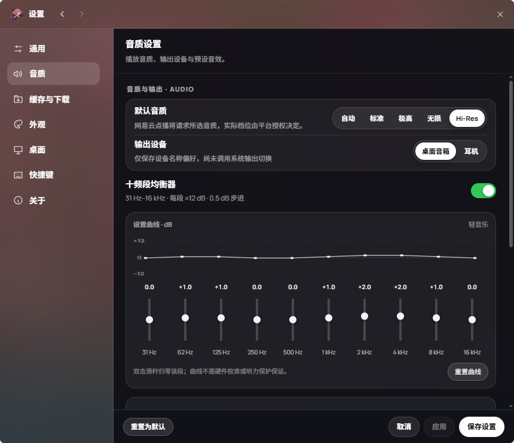

# 点播、播放队列与均衡器

## 从哪里开始播放

在搜索页选择网易云、酷我、酷狗或本地曲库，输入关键词并提交。在线搜索按服务端分页。选中一首在线结果后，播放器以这页结果建立队列，从该曲开始。首页发现歌单的快捷播放会先读完整份歌单，再建立对应队列。

点播期间播放键会显示等待状态。曲目返回试听或不可播时，查看底栏与曲目来源的提示。音质设置表达请求的档位，播放与下载结果以当前资源为准。

## 曲名、专辑与作品说明

搜索结果分开显示歌名、歌手、专辑和作品说明。例如搜索“学生会也有洞”可找到《ぴ》，网易云将它标注为“TV动画《学生会也有洞！》片尾曲”。选择歌曲后，这条说明会跟随曲目进入播放栏、正在播放面板和全屏舞台。酷狗与酷我使用各自平台的标注，缺少说明时显示已有曲目信息。

## 队列与键盘

打开底栏或全屏播放里的队列，可以查看数量、当前曲目及队列顺序。长队列保留完整数据，只创建视口附近的行。上下键逐首移动，Home 和 End 可到达首尾。离开队列后播放器继续使用原来的顺序。

| 播放器操作 | 按键 |
| --- | --- |
| 播放、暂停 | 空格 |
| 前进、后退五秒 | 右、左方向键 |
| 调大、调小音量 | 上、下方向键 |
| 静音、恢复 | M |

歌词行获得焦点时，上下键用于阅读歌词。按回车或空格可以跳到这句的时间点。[歌词操作](lyrics.md)

## 十段均衡器

在“设置 → 音质”展开均衡器。默认关闭。可以从平直、流行、摇滚等预设开始，或调整前级及每个频段，再保存自己的预设。设置曲线显示所选增益值。

| 频段 | 调整时常听到的变化 |
| --- | --- |
| 31、62、125 Hz | 低音下潜、底鼓和贝斯 |
| 250、500 Hz | 音乐厚度、乐器主体 |
| 1、2、4 kHz | 人声、拨弦与咬字 |
| 8、16 kHz | 明亮度、镲片与空气感 |

提升多个频段时，自动余量保护会为前级留出空间。调整使用平滑参数变化。“应用”提交设置并保留设置窗，“保存设置”提交后关闭。关闭 EQ 可恢复原声。音源不允许 Web Audio 处理时走可听的回退路径，界面会反映处理可用性。

## 恢复与检查

偏好和当前曲目使用稳定标识保存。重启可以恢复到此前的歌曲与进度，由用户主动开始播放。打开设置中的真实底栏频谱后，在支持分析的音源播放时观察条形响应。模拟回归使用 `pnpm check:equalizer` 和 `pnpm check:spectrum`；实际听感需要在目标输出设备上核对。
